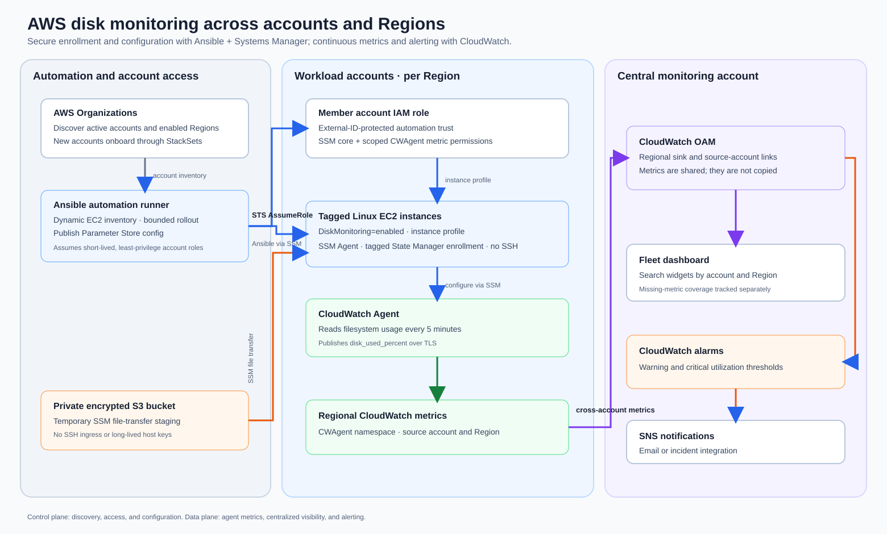
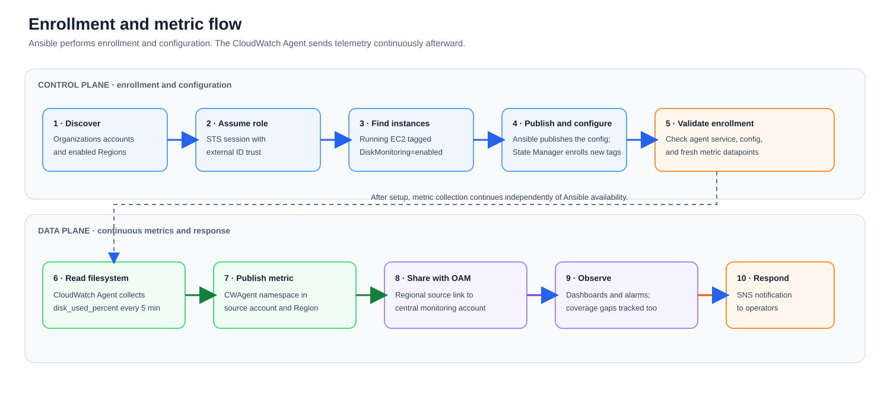

# Architecture and data flow

## High-level architecture

## Enrollment and metric flow

The setup path runs when accounts or instances are enrolled. Ansible publishes its rendered configuration to Parameter Store. A tag-targeted State Manager association installs and configures the agent when a matching EC2 instance registers with SSM. Rerun Ansible after changing the shared config. Once configured, the agent sends metrics without the Ansible controller.

The included rollout discovers active AWS Organization accounts and enabled Regions, uses the caller profile for its own account, and assumes the external-ID-protected monitoring role in other accounts. It selects running instances tagged `DiskMonitoring=enabled` and limits concurrent Ansible work. Deploy the State Manager association in each workload account and Region after seeding the Parameter Store configuration. New tagged instances are enrolled automatically; rerun Ansible when you change the shared configuration or need to validate the fleet.

## Key decisions
- **CloudWatch Agent rather than a custom cron script:** maintained agent, structured metrics, IAM-based publishing, and native alarms.
- **SSM rather than SSH:** outbound HTTPS management path, session/command audit trail, no fleet-wide private-key distribution, and simpler operations across private subnets.
- **Ansible for desired state:** version-controlled config and repeatable rollout; it is not the telemetry transport.
- **Central account for visibility:** separates workload administration from monitoring and notification administration. `cloudwatch/monitoring-account.yaml` creates the regional OAM sink and SNS topic; `cloudwatch/source-account-link.yaml` links metric data in each source Region.
- **Organization-aware rollout:** `scripts/enroll-organization.sh` runs only after role bootstrap, validates every assumed account, discovers opt-in Regions, and applies bounded concurrency. The single-account script remains the canary path.
- **Tag-based eligibility:** teams opt instances into the standard; production governance should enforce tags and instance profiles in launch templates/account vending.

## Coverage and failure modes
| Failure | Detection | Response |
|---|---|---|
| SSM Agent offline | SSM managed-node inventory check | Repair agent, instance role, DNS/endpoints, or egress |
| Agent missing/misconfigured | Ansible validation and State Manager association compliance | Reapply role or rerun the association, then verify agent status |
| Metrics absent | A separately scheduled coverage check should inspect recent `CWAgent` datapoints | Check agent logs, IAM, endpoints, namespace/region |
| Disk warning/critical | CloudWatch alarm | Run disk triage and cleanup/resize runbook |
| New account not onboarded | Organization account registry vs enabled account list | Add role, observability link, baseline stack |
| New EC2 not tagged | AWS Config / EventBridge / policy checks | Tag, remediate, or escalate per policy |
| Active account role missing/untrusted | Organization rollout fails assumed-account validation | Deploy/fix the role and trust before reporting complete coverage |
| Account/Region missing from central view | Compare Organizations and enabled Regions with OAM links and dashboard source inventory | Deploy regional sink/link and regenerate dashboard |

## Deployment artifacts

- Deploy `cloudwatch/monitoring-account.yaml` once per central monitoring Region and provide the `NotificationEmail` parameter; confirm the SNS subscription after the stack creates it.
- Deploy `cloudwatch/source-account-link.yaml` in each source account and Region with that Region's sink ARN. The source link shares CloudWatch metrics only.
- Deploy `cloudwatch/disk-monitoring-state-manager.yaml` in each workload account and Region after publishing the agent config parameter. It installs/configures the agent on tagged SSM managed instances.
- Maintain a JSON inventory of linked account IDs and Regions, render `cloudwatch/dashboard-template.json` with `scripts/render-dashboard.py`, then publish it with `aws cloudwatch put-dashboard` in the monitoring account.
- Deploy `cloudwatch/root-filesystem-alarm.yaml` in the monitoring account for each filesystem to create warning and critical alarms. Missing data remains distinct from healthy utilization.
- Bootstrap the automation role and trust with StackSets/account vending. The rollout script does not create IAM roles or OAM links and does not bypass failed accounts.
